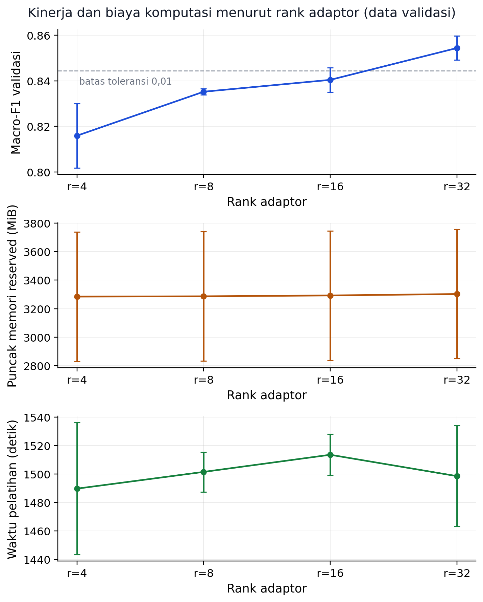
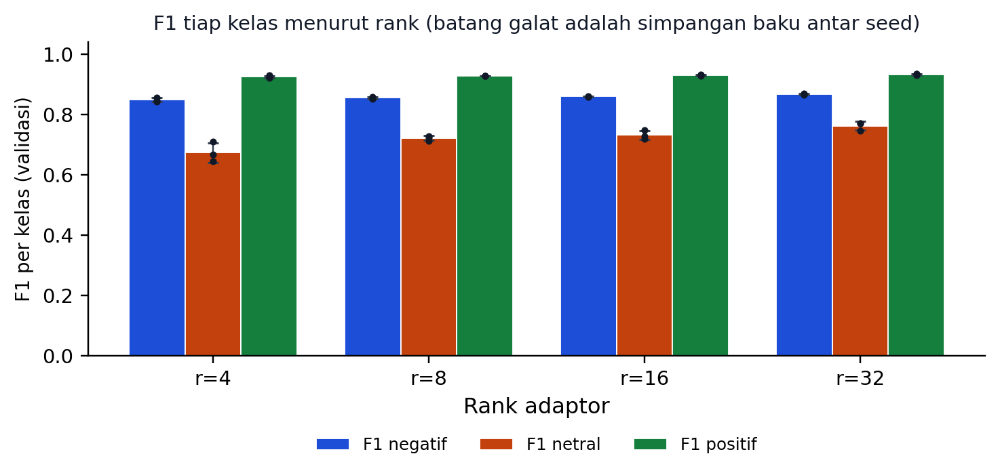

# Qwen2.5-0.5B + QLoRA: pengaruh rank adaptor pada sentimen bahasa Indonesia

Analisis eksperimen satu faktor: **apakah menaikkan rank adaptor QLoRA benar-benar memperbaiki klasifikasi sentimen, dan berapa biayanya pada GPU 4 GB?**

Ringkas jawabannya: pada konfigurasi ini Macro-F1 validasi naik pada setiap kenaikan rank, dari r=4 ke r=32, dan belum mendatar. Kenaikannya nyata tetapi tidak gratis: parameter terlatih naik delapan kali lipat sementara memori GPU hampir tetap, dan kenaikan terbesar justru pada kelas netral.

## Pertanyaan penelitian

1. Bagaimana perubahan rank adaptor memengaruhi Macro-F1, puncak memori GPU, dan durasi pelatihan pada Qwen2.5-0.5B-Instruct terkuantisasi 4-bit?
2. Rank terkecil mana yang layak pada perangkat 4 GB dan masih berada dalam toleransi 0,01 Macro-F1 dari hasil terbaik?

## Konfigurasi yang dibekukan sebelum eksperimen

| Butir | Nilai |
|---|---|
| Model dasar | `Qwen/Qwen2.5-0.5B-Instruct` |
| Kuantisasi | NF4 4-bit, double quantization, backbone beku, komputasi FP16 |
| Rank protokol | 4, 8, 16, 32 |
| Rasio alpha/rank | 2 (alpha = 2 x rank) |
| Modul target | q_proj, v_proj di seluruh lapisan |
| Seed | 42, 123, 2026 |
| Data latih | 2.000 baris subset terstratifikasi, seed 2026 |
| Optimasi | AdamW 8-bit, LR 0,0002, 3 epoch, warm-up 3,00%, tanpa early stopping |
| Batch | microbatch 1, akumulasi gradien 16, maksimum 256 token |
| Aturan pemilihan rank | rank terkecil dengan selisih Macro-F1 validasi tidak lebih dari 0,01 |
| Data uji | 500 baris, dibuka sekali setelah rank dibekukan |

## Hasil data validasi

| Rank | Macro-F1 (rata-rata 3 seed) | SD | F1 negatif | F1 netral | F1 positif | Parameter terlatih | Puncak reserved | Durasi |
|---|---|---|---|---|---|---|---|---|
| 4 | 0,8159 | 0,0141 | 0,8486 | 0,6737 | 0,9254 | 270.336 | 3284,7 MiB | 24,8 menit |
| 8 | 0,8352 | 0,0014 | 0,8556 | 0,7217 | 0,9283 | 540.672 | 3286,7 MiB | 25,0 menit |
| 16 | 0,8404 | 0,0054 | 0,8597 | 0,7315 | 0,9301 | 1.081.344 | 3292,7 MiB | 25,2 menit |
| 32 | 0,8544 | 0,0053 | 0,8678 | 0,7620 | 0,9334 | 2.162.688 | 3302,7 MiB | 25,0 menit |

Aturan pemilihan memilih **rank 32**. Hasil terbaik ada di rank 32 (0,8544), dan rank 16 berjarak 0,0140 dari hasil terbaik sehingga sudah di luar toleransi 0,01.

### Yang menarik dari angka ini

- **Kurva belum mendatar.** Kenaikan terkecil ada di langkah r=8 ke r=16 (0,0052), tetapi langkah r=16 ke r=32 justru memberi 0,0140. Pola ini berbeda dari laporan yang menemukan rank tidak berpengaruh jelas.
- **Kelas netral yang paling terbantu.** F1 netral bergerak dari 0,6737 ke 0,7620, sedangkan F1 positif hampir tetap (0,9254 ke 0,9334).
- **Memori nyaris tidak bergerak.** Puncak reserved hanya berubah 18,0 MiB walaupun parameter terlatih naik dari 270.336 ke 2.162.688.
- **Variasi antar seed untuk memori lebih besar daripada variasi antar rank.** Puncak reserved tiap run berkisar 2806,0 sampai 3726,0 MiB, jadi perbedaan memori antar rank tidak boleh dibaca sebagai efek yang pasti.

### Gambar hasil validasi





Confusion matrix rank terpilih dan jumlah parameter per rank tersedia di `docs/figures/`.

## Hasil data uji (rank terpilih dibekukan lebih dulu)

| Kondisi | Macro-F1 | F1 negatif | F1 netral | F1 positif |
|---|---|---|---|---|
| Tanpa adaptasi (zero-shot) | 0,2673 | 0,4870 | 0,3150 | 0,0000 |
| Adaptor rank 32, seed 42 | 0,8323 | 0,9108 | 0,7066 | 0,8796 |
| Adaptor rank 32, seed 123 | 0,8333 | 0,9060 | 0,7108 | 0,8831 |
| Adaptor rank 32, seed 2026 | 0,8267 | 0,8952 | 0,7006 | 0,8842 |
| Kelas mayoritas (batas bawah) | 0,1959 | 0,0000 | 0,0000 | 0,5876 |

Selisih rata-rata terhadap zero-shot: **0,5635**, selang kepercayaan bootstrap 95 persen [0,5196; 0,6104] dari 2.000 replikasi. Seluruh selang berada di atas nol, jadi adaptor memberi perbaikan yang tidak bergantung pada satu seed.

Dari 500 data uji, 48 data (9,6 persen) salah pada ketiga seed. Kesalahannya menumpuk di kelas netral: 25 dari 88 data netral salah konsisten, sedangkan kelas negatif hanya 8 dari 204 dan positif 15 dari 208. Contoh teks yang salah ada di lampiran laporan, bukan di repo ini.

## Uji tambahan di luar protokol: rank 64

Protokol hanya sampai rank 32. Setelah rank terpilih dibekukan, rank 64 dijalankan dengan 3 seed sebagai uji arah, bukan dasar pemilihan.

| Metrik | Nilai |
|---|---|
| Macro-F1 validasi | 0,8648 (SD 0,0079) |
| Selisih terhadap rank 32 | 0,0104 |
| F1 netral | 0,7829 |
| Parameter terlatih | 4.325.376 |
| Ukuran adaptor | 16,5 MiB |
| Puncak reserved | 3326,0 MiB |
| Durasi | 24,9 menit |

Artinya kenaikan belum berhenti di rank 32 pada model sekecil ini. Namun ada batas praktis: satu run rank 64 menyentuh 3.750 MiB dari 4.096 MiB yang tersedia, sehingga menaikkan rank lagi berisiko kehabisan memori pada perangkat kelas ini.

## Batasan

- Satu model 0,5 miliar parameter, satu dataset (SmSA), satu perangkat (RTX 2050 4 GB).
- Tiga seed per rank. Cukup untuk melihat arah sebaran, belum untuk klaim kestabilan.
- Hanya rank nominal yang divariasikan. Modul target, dropout, dan rasio alpha ditahan tetap.
- Hasil tidak dapat dipindahkan langsung ke model 7B atau dataset lain.

## Isi repositori

```
configs/config.json        seluruh parameter penelitian yang dibekukan
src/                       pipeline: data, model, latih, agregasi, uji akhir
analysis/                  pengolahan hasil dan pembuat README ini
data/processed/            train/valid/test SmSA hasil audit duplikat
runs/r*_s*/                hasil.json, pred_valid.csv, kurva loss per run
results/                   hasil uji, prediksi uji, rank terpilih, tabel agregat, gambar
docs/figures/              gambar hasil untuk dokumentasi
notes/                     changelog dan catatan lisensi
qwen25-05b-qlora-smsa.ipynb  alur lengkap versi Google Colab
```

Bobot dasar dan berkas adaptor tidak disertakan; keduanya diunduh atau dihasilkan ulang lewat skrip agar repo tetap ringan.

## Menjalankan ulang

```bash
pip install torch --index-url https://download.pytorch.org/whl/cu126
pip install -r requirements.txt
python src/01_download_data.py
python src/02_prepare_data.py
python src/03_download_model.py
python src/05_run_pilot.py          # uji kelayakan memori
python src/06_run_all.py            # 12 run protokol
python src/07_aggregate.py          # agregasi validasi + bekukan rank
python src/08_final_test.py         # buka data uji sekali
python analysis/olah_hasil_js10.py  # tabel dan gambar
python analysis/buat_readme.py      # README ini dibangkitkan ulang
```

## Sitasi dan lisensi

Sitasi tersedia pada `CITATION.cff`. Kode berlisensi MIT, data SmSA mengikuti lisensi aslinya di IndoNLU, dan model Qwen2.5 mengikuti lisensi Apache 2.0.
